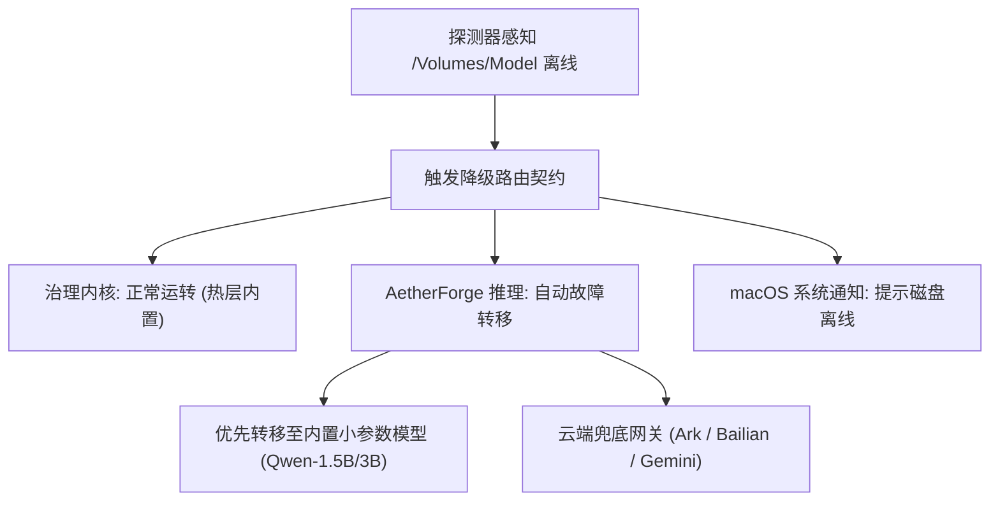

# 4.1T 存储盘掉线兜底与 T3 重建剧本

> 针对外挂大容量磁盘 (`/Volumes/Model`, `/Volumes/HD`) 意外离线或掉线时的保护机制、降级路由与自动自愈规约。

---

## 1. 架构原则：冷热数据严格物理分层

1. **热层数据 (Tier 0 / Tier 1) 恒定内置**：
   - SQLite 事件台账 (`event-ledger.sqlite3`)
   - Git 主干检出与 Worktree 工作区
   - OMO 状态机元数据 (`.omo/state/**`, `.omo/_truth/**`)
   - 必须 100% 停留在机器内置 SSD (`/System/Volumes/Data`)，**严禁软链接或移动到外挂盘**。
   - 外挂磁盘无论何时离线，治理系统、门禁审查与本地命令执行能力**零中断**。

2. **冷层数据 (Tier 2 / Tier 3) 外挂存储**：
   - 超过 5GB 的大语言模型权重与切片文件 (`/Volumes/Model/**`)
   - 历史长期冷数据归档 (`/Volumes/HD/**`)

---

## 2. 掉线感知与故障转移 (Failover) 契约

当 `bin/storage/storage-resilience-check.py` 探测到 `/Volumes/Model` 处于 `DISCONNECTED` 状态时：

1. **AetherForge 本地推理降级**：
   - 严禁因模型权重不可读而导致 Agent 死锁或报无意义空指针。
   - 推理网关捕获底层 `ENOENT / ModelNotFound` 异常，自动将请求转发至内置 SSD 的轻量级模型或云端备用 Endpoint。
2. **安全防护守门**：
   - 掉线期间，禁止任何后台任务对外挂路径执行写入尝试，防止在挂载点目录树内造出“幽灵文件”（Ghost Directory）。

---

## 3. T3 重新挂载与重建自愈剧本

当外挂磁盘重新插入或系统休眠唤醒恢复挂载后：
1. **自动重连感知**：
   - 守护进程运行 `python3 bin/storage/storage-resilience-check.py`，检测到状态恢复为 `NORMAL`。
2. **AetherForge 路由热重载**：
   - 推理网关恢复对 `/Volumes/Model` 的寻址，并预热 KV-Cache。
3. **元数据完整性校验**：
   - 验证大模型文件 SHA-256 签名无截断，解除系统降级警报。
